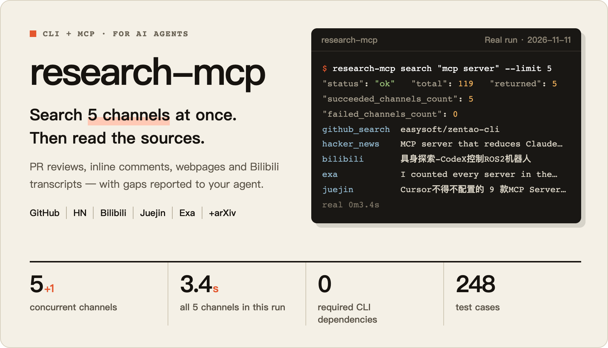
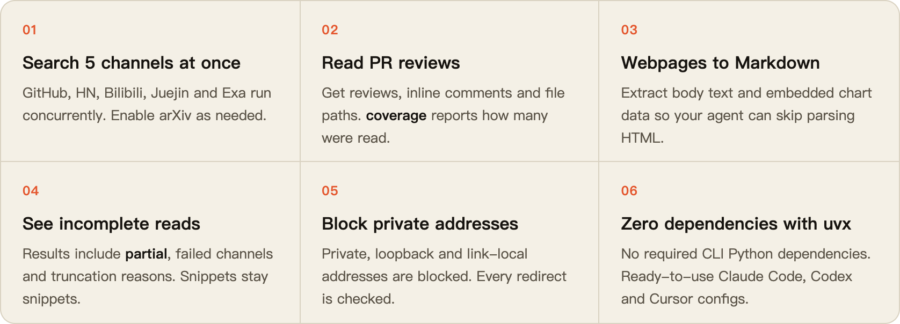
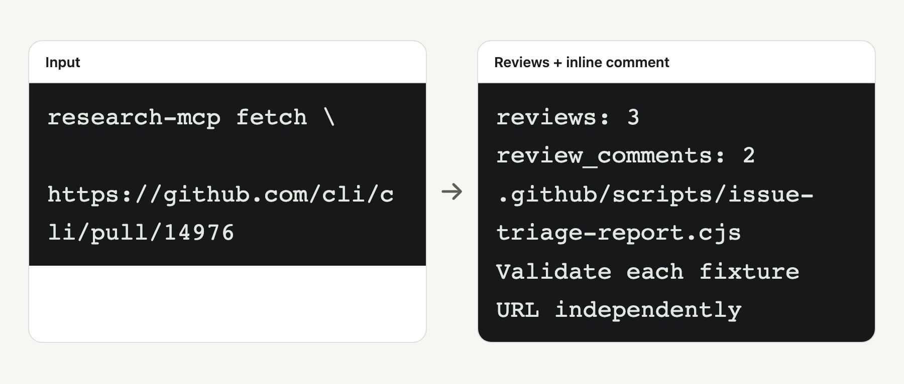
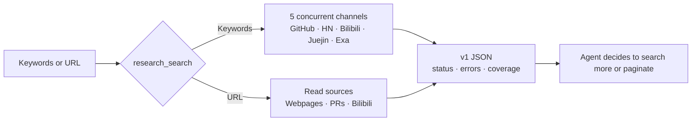

<div align="center">

<h1></h1>

[](https://github.com/bmdy6/research-mcp/actions/workflows/ci.yml)


[](LICENSE)

[Quick start](#quick-start) · [Features](#-features) · [Real output](#capabilities-and-real-output) · [FAQ](#faq-and-limitations) · [简体中文](README.md)

</div>

The terminal in the banner shows a real run on 2026-11-11: `search "mcp server" --limit 5` returned results from all 5 channels, pooled 119 candidates and took 3.4 seconds. Results vary with network conditions.

## Quick start

```sh
uvx --from git+https://github.com/bmdy6/research-mcp research-mcp --help
uvx --from git+https://github.com/bmdy6/research-mcp research-mcp search "mcp server" --limit 5
uvx --from git+https://github.com/bmdy6/research-mcp research-mcp fetch \
  https://github.com/cli/cli/pull/14976
```

MCP installs its SDK via `--with "mcp>=1.0,<3"`; see the [usage reference](docs/readme/reference.en.md).

<details><summary>Claude Code / Codex / Cursor · MCP configuration</summary>

**Claude Code · .mcp.json**

```json
{"mcpServers":{"research":{"command":"uvx","args":["--from","git+https://github.com/bmdy6/research-mcp","--with","mcp>=1.0,<3","research-mcp","mcp"]}}}
```

**Codex · .codex/config.toml**

```toml
[mcp_servers.research]
command = "uvx"
args = ["--from", "git+https://github.com/bmdy6/research-mcp", "--with", "mcp>=1.0,<3", "research-mcp", "mcp"]
```

**Cursor · .cursor/mcp.json**

```json
{"mcpServers":{"research":{"command":"uvx","args":["--from","git+https://github.com/bmdy6/research-mcp","--with","mcp>=1.0,<3","research-mcp","mcp"]}}}
```

</details>

## Why use it

An AI agent's built-in search may only return a page of snippets: it can miss PR reviews, cannot read Bilibili videos and may not tell you which sources failed. research-mcp combines search and source reading in one tool, and reports what it could not read.

| | Before | With research-mcp |
|---|---|---|
| Research a topic | Open separate tabs for GitHub, HN, Bilibili and Juejin | One command searches 5 channels concurrently, with source links |
| Read a PR | Get only the title and description | Get reviews, inline comments and file paths; `coverage` reports how many were read |
| A source fails | Silently lose part of the evidence while the agent still draws conclusions | Results include `partial`, failed channels and truncation reasons |
| Connect an agent | Install a separate tool for each platform | 1 MCP tool accepts both keywords and URLs |

## ✨ Features

<div align="center">

</div>

## Capabilities and real output

<picture>
  <source media="(prefers-color-scheme: dark)" srcset="docs/readme/hero-dark.png">
  
</picture>

A real PR read: review counts, inline comment counts, file paths and original comment excerpts.

These are real excerpts recorded on 2026-11-09, retaining the original field names; see the [usage reference](docs/readme/reference.en.md) for sources and usage. Network results vary; arXiv is enabled only when explicitly selected.

| Capability | Input | Real output excerpt |
|---|---|---|
| Multi-channel search | `mcp server` | `"status": "partial"`; `"succeeded_channels": ["hacker_news", "bilibili", "juejin"]` |
| Webpage body | `https://example.com` | `"via": "jina"`; `Title: Example Domain` |
| GitHub PR | `https://github.com/cli/cli/pull/14976` | `coverage.reviews.returned: 3`; `coverage.review_comments.returned: 2` |
| Bilibili fallback | `https://www.bilibili.com/video/BV1xx411c7mD` | `"status": "partial"`; `"hint": "设置 GROQ_API_KEY 环境变量"` |
| Chart data | An original JSON-LD Dataset fixture run through the real extractor | `### Sample`; `\| A \| 1.5 \|` |

The chart row is a local fixture run, not evidence of a successful online page read; extraction uses embedded page data, without image recognition. The Bilibili example retrieved only a webpage title and fallback content, without transcribing audio.

## How it works



1. Search keywords; `--providers` accepts `github_search,hacker_news,bilibili,exa,juejin,arxiv`.
2. Pass a candidate URL to `fetch`; the single MCP tool `research_search` accepts keywords or URLs.
3. Inspect `status`, `errors`, `truncated` and `coverage` before searching more or following pages.

## 🛡️ Reliability

- **248 test cases.** CI runs offline tests on Ubuntu / macOS × Python 3.10 / 3.13, plus a separate MCP stdio job.
- **Public HTTPS reads by default.** Private, loopback and link-local addresses are blocked; redirects are checked at every hop.
- **Keys come only from environment variables.** All three keys are optional; missing keys skip the corresponding capability and are explained in the result.

## Options

Requires Python >=3.10; Quick start installs directly from main without cloning, and needs [uv](https://docs.astral.sh/uv/getting-started/installation/) and network access. The CLI has no required Python runtime dependencies; stdio MCP needs the optional `[mcp]` SDK.

| Option | Purpose |
|---|---|
| `--limit` | CLI search defaults to 10, accepts 1–40; MCP defaults to 12. |
| `--providers` | A comma-separated CLI value or an MCP string array. |
| `--format json` | Emit v1 JSON; text currently also emits readable JSON. |

### Environment variables

| Variable | Purpose | When unset |
|---|---|---|
| `GROQ_API_KEY` | Bilibili audio transcription. | Skip transcription, attempt webpage fallback and suggest setting the key. |
| `EXA_API_KEY` | Your own Exa search quota. | Use the free MCP endpoint, which may rate-limit requests. |
| `AI_GATEWAY_API_KEY` | Optional relevance filtering. | Report `rerank: skipped_no_key` without paid filtering. |
| `RESEARCH_MCP_ALLOW_FAKE_IP` | Exactly `1` permits `198.18.0.0/15`. | Block that range and explain proxy fake-IP mode. |

### External commands

| Command | Impact when missing or unavailable | Installation |
|---|---|---|
| `gh` | GitHub search and repository/Issue/PR/file reading fail; other channels continue. The signed-in identity affects visibility. | [GitHub CLI](https://cli.github.com), then `gh auth login`. |
| `bili` | No backup search after Bilibili API failure or audio download; public API search and webpage fallback may still work. | `uv tool install 'bilibili-cli[audio]'`. |
| `curl` | Affects HN, Juejin, Bilibili API searches and Groq transcription; direct Exa and safe webpage reading do not require it. | Install curl with the system package manager. |

## Comparison with Agent Reach

Read on **2026-11-09**. This compares the statements and implementation at that time, not every version or runtime environment of either project.

| Aspect | research-mcp | Agent Reach |
|---|---|---|
| Entry point | Packaged CLI and single-tool stdio MCP. | README demonstrates `agent-reach <channel> <action>`, `read` and natural-language installation/management. |
| Platforms | Five default search channels, explicit arXiv; webpage, GitHub and Bilibili reads. | README lists Bilibili, V2EX, GitHub, YouTube and web as defaults, with optional and experimental channels. |
| Identity/config | Three optional keys from environment variables; GitHub reuses gh identity. | README describes copying existing browser login for some platforms, dedicated browsers and session management. |
| Failure/coverage | v1 JSON partial status, error codes, truncation and GitHub coverage. | README describes ordered preferred/backup tool lists per platform. |

Sources: [CLI](research_mcp/cli.py), [search/read core](research_mcp/research.py), [result contract](research_mcp/result_contract.py), [Agent Reach pinned README](https://github.com/Panniantong/Agent-Reach/blob/c70ae6da5d39bc90e09ad2ae0575ccc89f31e284/README.md) and [CLI implementation](https://github.com/Panniantong/Agent-Reach/blob/c70ae6da5d39bc90e09ad2ae0575ccc89f31e284/agent_reach/runtime/cli.py).

## FAQ and limitations

**Which addresses can it read?** It is intended for read-only public HTTPS; HTTP upgrades to HTTPS on the same host. The safe webpage path blocks private, loopback and link-local addresses and validates every redirect hop. GitHub uses authenticated gh APIs, so this is not an anonymous public-access boundary; do not use it as the basis for a public gateway.

**When should I enable fake-IP?** Only after confirming a trusted proxy maps domains into `198.18.0.0/15`; setting `1` relaxes that special non-public range and an incorrect DNS/proxy configuration may reach unintended targets. Other private ranges remain blocked; keep it unset on ordinary networks.

**Why are search results or transcripts missing?** Free Exa requests can be rate-limited; failure does not prove absence. Bilibili transcription needs `bili`, `GROQ_API_KEY` and downloadable audio; downloads may additionally need login/audio dependencies. Without a key, webpage fallback is not guaranteed to succeed and does not mean the video has been fully read.

**Why does HTTPS fail on a Mac?** With python.org Python, first run `Install Certificates.command` in its installation directory, as the [official Python installation instructions](https://docs.python.org/3/using/mac.html) require; keep certificate validation enabled. All three client configurations passed stdio tool discovery and a tool call with their exact argv; this does not establish GUI acceptance.

## Contributing

Include your Python version, command and redacted error codes in an issue; CI runs offline tests on Ubuntu/macOS × Python 3.10/3.13 and a separate optional MCP stdio job.

## License

[MIT](LICENSE). Source and transcript rights remain with their owners; follow upstream terms.

<div align="center">

If this helps, leave a ⭐. Have a channel in mind? Open an issue.

</div>
