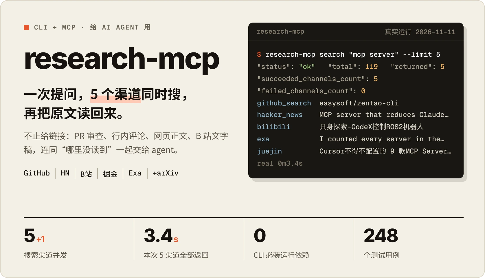
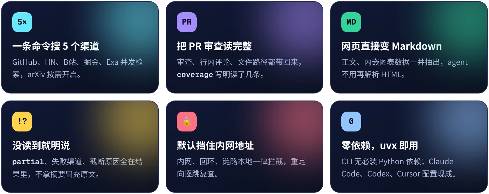
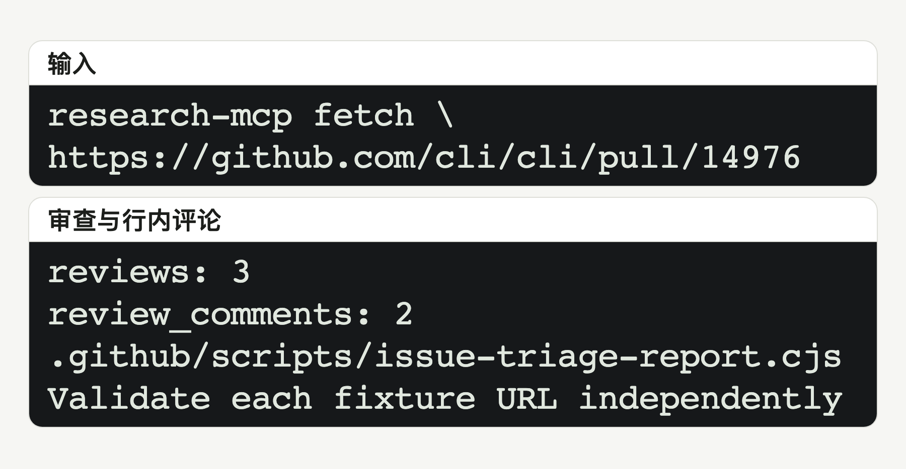
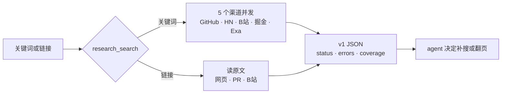

<div align="center">

<h1></h1>

[](https://github.com/bmdy6/research-mcp/actions/workflows/ci.yml)


[](LICENSE)

[快速开始](#快速开始) · [功能](#-功能) · [真实输出](#能力与真实输出) · [常见问题](#常见问题与限制) · [English](README.en.md)

</div>

横幅里的终端是 2026-11-11 的真实运行：`search "mcp server" --limit 5`，5 个渠道全部返回，汇集 119 条候选，用时 3.4 秒；结果随网络变化。

## 为什么需要它

AI agent 自带的搜索只给一页摘要：看不到 PR 里的审查意见，读不了 B 站视频，哪个来源失败了也不会说。research-mcp 把“搜”和“读原文”合成一个工具，并且把没读到的部分写进结果。

| | 以前 | 用 research-mcp |
|---|---|---|
| 查一个话题 | GitHub、HN、B站、掘金各开一个标签页 | 一条命令，5 个渠道并发，结果带来源 |
| 读一个 PR | 只拿到标题和描述 | 审查、行内评论、文件路径，`coverage` 写明读了几条 |
| 来源失败 | 悄悄少一块，agent 照样下结论 | `partial`、失败渠道、截断原因都在结果里 |
| 接入 agent | 每个平台装一个工具 | 1 个 MCP 工具，关键词和链接都收 |

## ✨ 功能

<div align="center">

</div>

## 快速开始

```sh
uvx --from git+https://github.com/bmdy6/research-mcp research-mcp --help
uvx --from git+https://github.com/bmdy6/research-mcp research-mcp search "mcp server" --limit 5
uvx --from git+https://github.com/bmdy6/research-mcp research-mcp fetch \
  https://github.com/cli/cli/pull/14976
```

MCP 通过 `--with "mcp>=1.0,<3"` 安装 SDK；详见[使用说明](docs/readme/reference.zh-CN.md)。

<details><summary>Claude Code / Codex / Cursor · MCP 配置</summary>

**Claude Code · .mcp.json**

```json
{"mcpServers":{"research":{"command":"uvx","args":["--from","git+https://github.com/bmdy6/research-mcp","--with","mcp>=1.0,<3","research-mcp","mcp"]}}}
```

**Codex · .codex/config.toml**

```toml
[mcp_servers.research]
command = "uvx"
args = ["--from", "git+https://github.com/bmdy6/research-mcp", "--with", "mcp>=1.0,<3", "research-mcp", "mcp"]
```

**Cursor · .cursor/mcp.json**

```json
{"mcpServers":{"research":{"command":"uvx","args":["--from","git+https://github.com/bmdy6/research-mcp","--with","mcp>=1.0,<3","research-mcp","mcp"]}}}
```

</details>

## 能力与真实输出

<picture>
  <source media="(prefers-color-scheme: dark)" srcset="docs/readme/hero-dark.zh-CN.png">
  
</picture>

真实 PR 读取：审查数、行内评论数、文件路径和原评论节选。

以下是 2026-11-09 的真实运行节选，保留原字段名；来源和使用方式见[使用说明](docs/readme/reference.zh-CN.md)。网络结果会变化，arXiv 仅在显式指定时启用。

| 能力 | 输入 | 真实输出节选 |
|---|---|---|
| 多渠道搜索 | `mcp server` | `"status": "partial"`；`"succeeded_channels": ["hacker_news", "bilibili", "juejin"]` |
| 网页正文 | `https://example.com` | `"via": "jina"`；`Title: Example Domain` |
| GitHub PR | `https://github.com/cli/cli/pull/14976` | `coverage.reviews.returned: 3`；`coverage.review_comments.returned: 2` |
| B站回退 | `https://www.bilibili.com/video/BV1xx411c7mD` | `"status": "partial"`；`"hint": "设置 GROQ_API_KEY 环境变量"` |
| 图表数据 | 自制 JSON-LD Dataset 样本，经真实抽取函数运行 | `### Sample`；`\| A \| 1.5 \|` |

图表项是本地样本实跑，不是在线页面读取成功的证明；只抽取页面内嵌数据，不做图像识别。B站例子只取得网页标题和回退内容，未转写音频。

## 工作流程




1. 用关键词搜索；`--providers` 可选 `github_search,hacker_news,bilibili,exa,juejin,arxiv`。
2. 把候选链接传给 `fetch`；MCP 的单工具 `research_search` 同时接受关键词或链接。
3. 检查 `status`、`errors`、`truncated` 和 `coverage`，再决定是否补搜或翻页。

## 🛡️ 靠得住的地方

- **210 个测试用例。** CI 在 Ubuntu / macOS × Python 3.10 / 3.13 上跑离线测试，另单跑一次 MCP stdio。
- **默认只读公开 HTTPS。** 内网、回环和链路本地地址一律拦截，重定向逐跳复查。
- **密钥只走环境变量。** 三个 key 全部可选；不设置就跳过对应能力，并在结果里说明。

## 选项

需要 Python >=3.10；上手命令直接从 main 安装，无需克隆；需 [uv](https://docs.astral.sh/uv/getting-started/installation/) 和网络。CLI 无必装 Python 运行依赖，stdio MCP 需可选 `[mcp]` SDK。

| 参数 | 作用 |
|---|---|
| `--limit` | CLI 搜索默认 10，范围 1–40；MCP 默认 12。 |
| `--providers` | CLI 用逗号分隔，MCP 用字符串数组。 |
| `--format json` | 输出 v1 JSON；text 当前也输出可读 JSON。 |

### 环境变量

| 变量 | 用途 | 不设置时 |
|---|---|---|
| `GROQ_API_KEY` | B站音频转写。 | 不转写；尝试网页回退，提示设置 key。 |
| `EXA_API_KEY` | 自备 Exa 搜索额度。 | 使用免费 MCP 端点，可能限流。 |
| `AI_GATEWAY_API_KEY` | 可选相关性筛选。 | `rerank: skipped_no_key`，不调用付费筛选。 |
| `RESEARCH_MCP_ALLOW_FAKE_IP` | 精确为 `1` 时放行 `198.18.0.0/15`。 | 拦截该网段并提示代理 fake-ip 原因。 |

### 外部命令

| 命令 | 缺少或不可用的影响 | 安装入口 |
|---|---|---|
| `gh` | GitHub 搜索、仓库/Issue/PR/文件读取不可用；其他渠道继续。登录身份的权限会影响可见内容。 | [GitHub CLI](https://cli.github.com)，安装后 `gh auth login`。 |
| `bili` | B站 API 失败后的搜索备选及音频下载不可用；公开 API 搜索和网页回退仍可能成功。 | `uv tool install 'bilibili-cli[audio]'`。 |
| `curl` | HN、掘金、B站 API 搜索与 Groq 转写受影响；Exa 直连和安全网页读取不依赖它。 | 用系统包管理器安装 curl。 |

## 与 Agent Reach 对比

读取日期 **2026-11-09**。只比较当前声明和实现，不代表双方所有版本或运行环境。

| 维度 | research-mcp | Agent Reach |
|---|---|---|
| 操作入口 | 本包 CLI + 单工具 stdio MCP。 | README 展示 `agent-reach <渠道> <动作>`、`read` 和自然语言安装管理。 |
| 平台范围 | 默认五个搜索渠道，显式 arXiv；网页、GitHub、B站读取。 | README 默认列 B站、V2EX、GitHub、YouTube、web；另有可选和实验渠道。 |
| 登录与配置 | 三个可选 key 从环境变量读取；GitHub 使用已有 gh 身份。 | README 说明部分平台复制已有浏览器登录，并提供专用浏览器与会话管理。 |
| 失败与覆盖 | v1 JSON 的 partial、错误码、截断和 GitHub coverage。 | README 说明每个平台按有序工具列表尝试首选和备选。 |

依据：[本包入口](research_mcp/cli.py)、[搜索与读取](research_mcp/research.py)、[结果契约](research_mcp/result_contract.py)，以及 [Agent Reach README 固定快照](https://github.com/Panniantong/Agent-Reach/blob/c70ae6da5d39bc90e09ad2ae0575ccc89f31e284/README.md)与[CLI 实现](https://github.com/Panniantong/Agent-Reach/blob/c70ae6da5d39bc90e09ad2ae0575ccc89f31e284/agent_reach/runtime/cli.py)。

## 常见问题与限制

**能读取哪些地址？** 设计用途是只读公开 HTTPS；HTTP 会先升级为同主机 HTTPS。安全网页链拦截内网、回环和链路本地地址，并逐跳检查重定向；GitHub 走有权限的 gh API，不是匿名公开边界，不要据此部署公共网关。

**什么时候开 fake-ip？** 仅在确认可信代理把域名解析到 `198.18.0.0/15` 时设为 `1`；这会放宽该特殊非公网网段，错误的 DNS/代理配置可能访问非预期目标。其他私网仍拦截，普通网络不要开启。

**为什么搜不到或没有文字稿？** Exa 免费通道会限流，失败不等于不存在；B站转写需要 `bili`、`GROQ_API_KEY` 和可下载音频，下载链还可能需要登录/音频依赖。没有 key 时网页回退不保证成功，也不等于视频已读完。

**Mac 上 HTTPS 失败怎么办？** python.org 版 Python 先运行安装目录中的 `Install Certificates.command`；这是 [Python 官方安装步骤](https://docs.python.org/3/using/mac.html)，不要关闭证书校验。三款客户端的配置均已按原 argv 通过 stdio 工具发现和调用；这不等于 GUI 界面操作已验收。

## 参与贡献

提交问题时附 Python 版本、命令和脱敏后的错误码；CI 在 Ubuntu/macOS × Python 3.10/3.13 跑离线测试，并单跑可选 MCP stdio。

## 许可证

[MIT](LICENSE)。网页及转写内容的权利归原权利人；请遵守上游条款。

<div align="center">

觉得有用就点个 ⭐，下一个渠道加什么，欢迎提 Issue。

</div>
