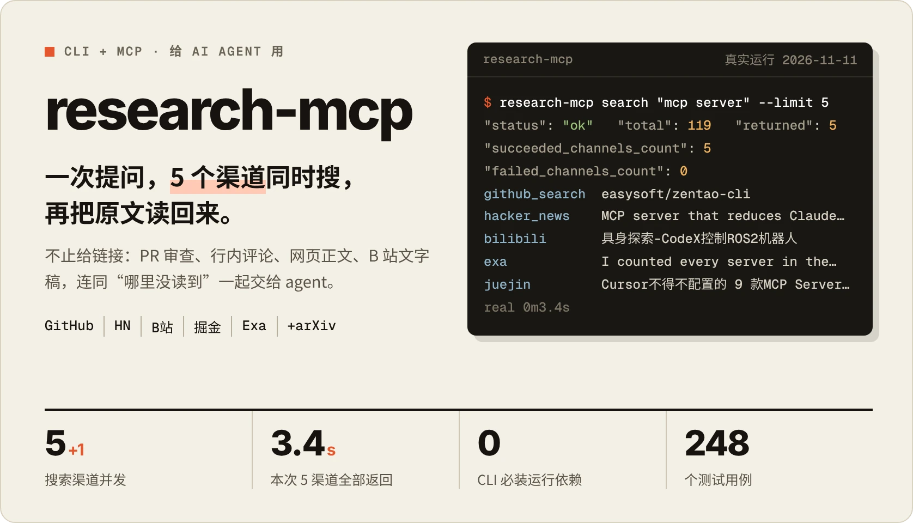
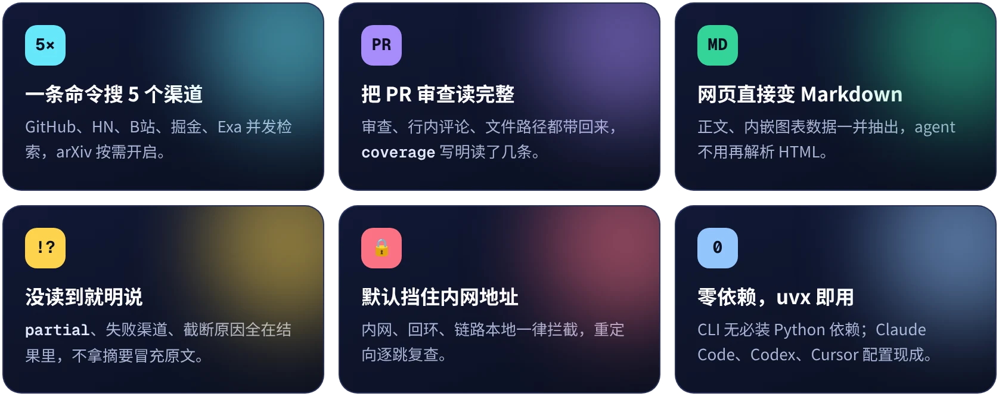
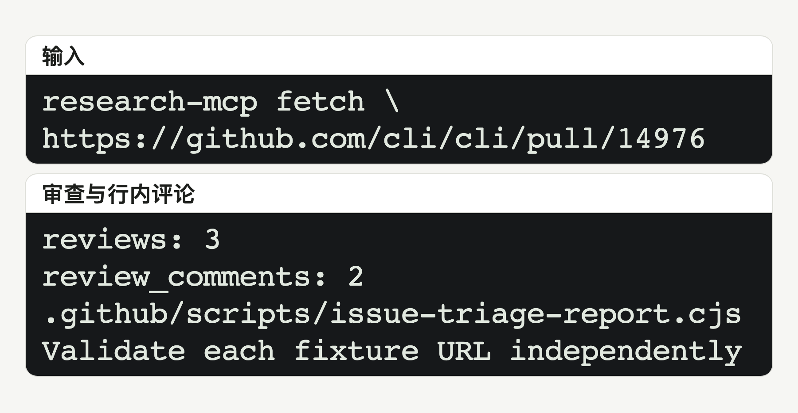
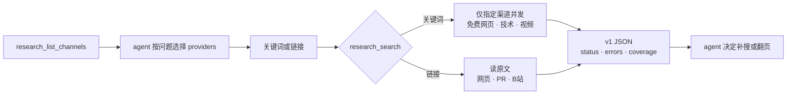

<div align="center">

<h1></h1>

[](https://github.com/bmdy6/research-mcp/actions/workflows/ci.yml)


[](LICENSE)

[快速开始](#快速开始) · [功能](#-功能) · [真实输出](#能力与真实输出) · [常见问题](#常见问题与限制) · [English](README.en.md)

</div>

横幅记录旧版默认全源搜索（2026-11-11）：`search "mcp server" --limit 5`，5 个渠道全部返回，汇集 119 条候选，用时 3.4 秒；当前版本有小组免费默认渠道，建议先列目录、按题选渠道，见下文；旧图不代表当前默认行为。

## 快速开始

```sh
uvx --from git+https://github.com/bmdy6/research-mcp research-mcp --help
uvx --from git+https://github.com/bmdy6/research-mcp research-mcp channels --format json
uvx --from git+https://github.com/bmdy6/research-mcp research-mcp search "mcp server" --providers hacker_news --limit 5
uvx --from git+https://github.com/bmdy6/research-mcp research-mcp fetch \
  https://github.com/cli/cli/pull/14976
```

MCP 通过 `--with "mcp>=1.0,<3"` 安装 SDK；详见[使用说明](docs/readme/reference.zh-CN.md)。

<details><summary>Claude Code / Codex / Cursor · MCP 配置</summary>

**Claude Code · .mcp.json**

```json
{"mcpServers":{"research":{"command":"uvx","args":["--from","git+https://github.com/bmdy6/research-mcp","--with","mcp>=1.0,<3","research-mcp","mcp"]}}}
```

**Codex · .codex/config.toml**

```toml
[mcp_servers.research]
command = "uvx"
args = ["--from", "git+https://github.com/bmdy6/research-mcp", "--with", "mcp>=1.0,<3", "research-mcp", "mcp"]
```

**Cursor · .cursor/mcp.json**

```json
{"mcpServers":{"research":{"command":"uvx","args":["--from","git+https://github.com/bmdy6/research-mcp","--with","mcp>=1.0,<3","research-mcp","mcp"]}}}
```

</details>

## 为什么需要它

AI agent 自带的搜索有时只给一页摘要：可能漏掉 PR 里的审查意见，无法读取 B 站视频，也可能不说明哪些来源失败了。research-mcp 把“搜”和“读原文”合成一个工具，并且把没读到的部分写进结果。

| | 以前 | 用 research-mcp |
|---|---|---|
| 查一个话题 | GitHub、HN、B站、掘金各开一个标签页 | 由 agent 选渠道，一条命令并发搜索，结果带来源 |
| 读一个 PR | 只拿到标题和描述 | 审查、行内评论、文件路径，`coverage` 写明读了几条 |
| 来源失败 | 悄悄少一块，agent 照样下结论 | `partial`、失败渠道、截断原因都在结果里 |
| 接入 agent | 每个平台装一个工具 | 2 个 MCP 工具：列目录，以及搜索/读原文 |

## ✨ 功能

<div align="center">

</div>

## 能力与真实输出

<picture>
  <source media="(prefers-color-scheme: dark)" srcset="docs/readme/hero-dark.zh-CN.png">
  
</picture>

真实 PR 读取：审查数、行内评论数、文件路径和原评论节选。

以下是 2026-11-09 的真实运行节选，保留原字段名；来源和使用方式见[使用说明](docs/readme/reference.zh-CN.md)。网络结果会变化，arXiv 仅在显式指定时启用。

| 能力 | 输入 | 真实输出节选 |
|---|---|---|
| 多渠道搜索 | `mcp server` | `"status": "partial"`；`"succeeded_channels": ["hacker_news", "bilibili", "juejin"]` |
| 网页正文 | `https://example.com` | `"via": "jina"`；`Title: Example Domain` |
| GitHub PR | `https://github.com/cli/cli/pull/14976` | `coverage.reviews.returned: 3`；`coverage.review_comments.returned: 2` |
| B站回退 | `https://www.bilibili.com/video/BV1xx411c7mD` | `"status": "partial"`；`"hint": "设置 GROQ_API_KEY 环境变量"` |
| 图表数据 | 自制 JSON-LD Dataset 样本，经真实抽取函数运行 | `### Sample`；`\| A \| 1.5 \|` |

图表项是本地样本实跑，不是在线页面读取成功的证明；只抽取页面内嵌数据，不做图像识别。B站例子只取得网页标题和回退内容，未转写音频。

## 工作流程




1. 先调用 `research_list_channels`（CLI：`research-mcp channels`），再显式选择 `providers`；省略或传空数组时使用默认免费组 `bing,baidu,exa`，返回 `used_default_providers=true` 和说明；用环境变量 `RESEARCH_DEFAULT_PROVIDERS=hacker_news,baidu` 可覆盖，空值恢复内置默认。
2. 把候选链接传给 `fetch`；MCP 的 `research_search` 同时接受关键词或链接。
3. 检查 `status`、`errors`、`truncated` 和 `coverage`，再决定是否补搜或翻页。

## 🛡️ 靠得住的地方

- **267 个测试用例。** CI 在 Ubuntu / macOS × Python 3.10 / 3.13 上跑离线测试，另验证 MCP SDK 1.x/2.x 的 stdio。
- **默认只读公开 HTTPS。** 内网、回环和链路本地地址一律拦截，重定向逐跳复查。
- **关键词搜索只走免费路径。** 不读取 Exa 付费 key，不调用路由或重排模型；缺依赖和限流按渠道说明。URL 读取中的可选转写保持原有独立配置。

## 选项

需要 Python >=3.10；上手命令直接从 main 安装，无需克隆；需 [uv](https://docs.astral.sh/uv/getting-started/installation/) 和网络。CLI 无必装 Python 运行依赖，stdio MCP 需可选 `[mcp]` SDK。

| 参数 | 作用 |
|---|---|
| `--limit` | CLI 搜索默认 10，范围 1–40；MCP 默认 12。 |
| `--providers` | 搜索必传；CLI 用逗号分隔，MCP 用字符串数组。URL 读取忽略它。 |
| `--format json` | 输出 v1 JSON；text 当前也输出可读 JSON。 |

### 环境变量

| 变量 | 用途 | 不设置时 |
|---|---|---|
| `GROQ_API_KEY` | B站音频转写。 | 不转写；尝试网页回退，提示设置 key。 |
| `EXA_API_KEY` | 搜索忽略此变量，固定免 key 端点。 | 限流立即停止，当前进程冷却 5 分钟。 |
| `AI_GATEWAY_API_KEY` | CLI/MCP/共享 service 搜索均忽略，不执行模型重排。 | `rerank_downgraded: disabled_by_transport_policy`。 |
| `OPEN_WEBSEARCH_ROOT` | 可选：指向下面固定版本的源码安装目录。 | 查找用户缓存中的固定 revision；未安装则 `startup_failed`。 |
| `TAVILY_API_KEY` / `OPENALEX_API_KEY` | 官方 API 的免费 key；对应 `*_FREE_ONLY=1` 才启用。 | 只从环境变量读取；不要把 key 写入仓库或命令参数。 |
| `RESEARCH_MCP_ALLOW_FAKE_IP` | 精确为 `1` 时放行 `198.18.0.0/15`。 | 拦截该网段并提示代理 fake-ip 原因。 |

### 外部命令

| 命令 | 缺少或不可用的影响 | 安装入口 |
|---|---|---|
| `gh` | GitHub 搜索、仓库/Issue/PR/文件读取不可用；其他渠道继续。登录身份的权限会影响可见内容。 | [GitHub CLI](https://cli.github.com)，安装后 `gh auth login`。 |
| `bili` | B站 API 失败后的搜索备选及音频下载不可用；公开 API 搜索和网页回退仍可能成功。 | `uv tool install 'bilibili-cli[audio]'`。 |
| `curl` | HN、掘金、B站 API、Exa 搜索与 Groq 转写受影响；安全网页读取不依赖它。 | 用系统包管理器安装 curl。 |

## 免费渠道目录与选源

现有目录登记 23 个可选渠道，含 11 个官方 API 渠道及 CSDN；没有 key、没有登录也能启动；HN、网页渠道等各自工作，失败不会中断其他渠道。

| 渠道 ID | 内容 / 适合语言 | 条件与费用 |
|---|---|---|
| `baidu`、`sogou` | 中文网页、国内信息 | 免 key；可选 open-webSearch 请求子进程；反爬时 `blocked` |
| `bing`、`duckduckgo` | 中英文网页 | 同上；本出口 Bing 英文长查询相关性较弱，优先试 DDG |
| `exa` | 语义网页、站内线索 | 官方免 key MCP + curl；429/402 即停，不回退付费 |
| `github_search` | 仓库、实现线索 | 免费；需 `gh` 和已有登录身份 |
| `hacker_news` | 英文技术讨论 | 免 key；Algolia 公开 API |
| `juejin` | 中文工程文章 | 免 key；公开搜索接口 |
| `bilibili` | 课程、演示、评测 | 免 key 搜索；API 不通时可尝试已有 bili CLI |
| `jd` | 京东商品，中文 | `local_browser`，仅本机 Ego Lite、已有登录态、显式启用；成功查询验收待权限恢复 |
| `arxiv` | 英文论文 | 免 key；默认全部论文，`ARXIV_REQUIRE_GITHUB=1` 可限定 GitHub 链接 |
| `tavily`、`openalex` | 通用网页 / 学术 | `free_recurring`，免费 key + 对应 `*_FREE_ONLY=1`；请求前核验配额 |

目录包含 `cost_class`、`requires_key`、`requires_login`、`languages`、`content_type`、`quota_remaining`、`status`、`last_checked_at`、`license`、`upstream_terms`、`actual_backend`。`unchecked` 仅表示可尝试；`quota_remaining: null` 是未知；状态只记当前服务进程的查询尝试（可能因限流熔断而不发请求），不主动探测、不返回凭据。本机浏览器目前仅注册已读到商品列表的京东；其余购物、社区及自托管渠道未接入。

让调用方 agent 按问题选择，每题先用 1–2 个互补源，必要时换源或改词；服务不调用另一个收费模型来做决策，共享搜索即使收到旧参数 `rerank=True` 也强制关闭模型重排；显式启用的旧内部 Python 重排函数与此免费入口分开：

- 国内信息 → `baidu`，需要补充时 `sogou`；被拦就换公开来源。
- 英文概念 / 官网 → `duckduckgo`，补 `exa` 或 `bing`；不要把共享索引当成独立佐证。
- 报错 / 实现 → `github_search` + `stackexchange` + `juejin` + `csdn`，官方文档可加网页 `site:` 查询。
- 论文 → `arxiv` + `openalex` + `crossref`；arXiv 的 GitHub 链接过滤默认关闭。
- 买东西 → 优先用京东/淘宝/什么值得买查商品与标价，再用 B站看评测。目前只接入京东 `jd`（需本机启用，成功查询验收待完成）和 `bilibili`；淘宝/什么值得买未接入，用网页 `site:` 只算线索。

```json
{"query":"Docker compose depends_on healthcheck","providers":["duckduckgo"],"limit":5}
```

### 可选安装网页引擎与 CSDN

基础 CLI 仍无必装 Python 运行依赖。网页引擎额外需要 Node.js >=20、npm、git，并显式安装上游；搜索和 MCP 启动不会自动下载：

```sh
git clone https://github.com/bmdy6/research-mcp.git
cd research-mcp
python3 scripts/install_open_websearch.py
research-mcp search "检索增强生成" --providers baidu,duckduckgo --limit 5
```

若未安装本包，最后一行可用 `python3 -m research_mcp search ...`。安装器固定 open-webSearch **2.2.0** / commit `2562c9233a945c18fa9d08b7e450ca218a8853b6`，执行上游 lockfile 的 `npm ci --ignore-scripts` 和构建。安装目录在用户缓存，`OPEN_WEBSEARCH_ROOT` 仅可指向该 revision 的构建目录；每次搜索核验 commit。Python 通过小型 Node bridge 调用上游搜索服务，固定 `SEARCH_MODE=request`，一个子进程只指定一个引擎，不走上游 CLI 的自动 daemon 路由，也不启动浏览器。源码和依赖的许可见 [第三方说明](THIRD_PARTY_NOTICES.md)。

### 逐渠道状态

`channel_statuses` 区分 `ok`、`empty`、`blocked`、`auth_required`、`quota_exhausted`、`parse_error`、`startup_failed`、`timeout`、`connection_failed`、`unsupported`。失败的同名状态也写入 `failed_channels[].status`；上游报错只映射固定短消息，不回显 key、路径或原始异常。HTTP 200 + 上游 `partialFailures` 仍判失败，不能当空结果。结果保留发现渠道、实际后端和原始排名。

[2026-11-23 真实验收与 20 题对比](docs/acceptance-2026-11-23.md)记录通过、限流、反爬和未完成的浏览器测试；这些是一次本机观察，不是上游可用性承诺。

## 与 Agent Reach 对比

读取日期 **2026-11-09**。只比较当前声明和实现，不代表双方所有版本或运行环境。

| 维度 | research-mcp | Agent Reach |
|---|---|---|
| 操作入口 | 本包 CLI + 目录/搜索两个 stdio MCP 工具。 | README 展示 `agent-reach <渠道> <动作>`、`read` 和自然语言安装管理。 |
| 平台范围 | 23 个可选搜索渠道；先列目录，按题选源；网页、GitHub、B站读取。 | README 默认列 B站、V2EX、GitHub、YouTube、web；另有可选和实验渠道。 |
| 登录与配置 | 免费搜索不读取付费 key；GitHub 使用已有 gh 身份；转写独立配置。 | README 说明部分平台复制已有浏览器登录，并提供专用浏览器与会话管理。 |
| 失败与覆盖 | v1 JSON 的 partial、错误码、截断和 GitHub coverage。 | README 说明每个平台按有序工具列表尝试首选和备选。 |

依据：[本包入口](research_mcp/cli.py)、[搜索与读取](research_mcp/research.py)、[结果契约](research_mcp/result_contract.py)，以及 [Agent Reach README 固定快照](https://github.com/Panniantong/Agent-Reach/blob/c70ae6da5d39bc90e09ad2ae0575ccc89f31e284/README.md)与[CLI 实现](https://github.com/Panniantong/Agent-Reach/blob/c70ae6da5d39bc90e09ad2ae0575ccc89f31e284/agent_reach/runtime/cli.py)。

## 常见问题与限制

**能读取哪些地址？** 设计用途是只读公开 HTTPS；HTTP 会先升级为同主机 HTTPS。安全网页链拦截内网、回环和链路本地地址，并逐跳检查重定向；GitHub 走有权限的 gh API，不是匿名公开边界，不要据此部署公共网关。

**什么时候开 fake-ip？** 仅在确认可信代理把域名解析到 `198.18.0.0/15` 时设为 `1`；这会放宽该特殊非公网网段，错误的 DNS/代理配置可能访问非预期目标。其他私网仍拦截，普通网络不要开启。

**为什么搜不到或没有文字稿？** Exa 免费通道会限流，失败不等于不存在；B站转写需要 `bili`、`GROQ_API_KEY` 和可下载音频，下载链还可能需要登录/音频依赖。没有 key 时网页回退不保证成功，也不等于视频已读完。

**Mac 上 HTTPS 失败怎么办？** python.org 版 Python 先运行安装目录中的 `Install Certificates.command`；这是 [Python 官方安装步骤](https://docs.python.org/3/using/mac.html)，不要关闭证书校验。三款客户端的配置均已按原 argv 通过 stdio 工具发现和调用；这不等于 GUI 界面操作已验收。

## 参与贡献

提交问题时附 Python 版本、命令和脱敏后的错误码；CI 在 Ubuntu/macOS × Python 3.10/3.13 跑离线测试，并单跑可选 MCP stdio。

## 许可证

[MIT](LICENSE)。网页及转写内容的权利归原权利人；请遵守上游条款。

<div align="center">

觉得有用就点个 ⭐，下一个渠道加什么，欢迎提 Issue。

</div>


### API 渠道与按问题选源

下表补充同一目录中的 API 类渠道。默认组仍是 bing、baidu、exa；新增渠道都由 agent 点名。中英文实测数据和限制见 [本轮 API 验收](docs/acceptance-api-2026-11-23.md)。

| 渠道 ID | 内容 | 免费条件 |
|---|---|---|
| `tavily` | 全网网页，固定 basic | Researcher 免费账号，PAYG 关闭；环境变量 key + FREE_ONLY，调用前核对免费额度 |
| `openalex` | 学术论文元数据与摘要 | Free Plan；环境变量 key + FREE_ONLY；每日免费预算、零预付余额核验 |
| `wikipedia`, `wikidata` | 百科、实体 | 官方 API，免 key；中文输入用中文接口 |
| `crossref`, `europe_pmc`, `pubmed` | DOI/学术、生物医学 | 官方 API，免 key；医学主题检索不等于医疗建议 |
| `stackexchange` | Stack Overflow 技术问答 | 官方 API，免 key；遵守 backoff 和 quota_remaining |
| `huggingface` | 公开模型 | Hub API 免 key，当前只搜模型名，不涵盖全部数据集和 Spaces |
| `openlibrary` | 图书 | 官方 API 免 key |
| `itunes_podcasts` | 播客节目 | Apple Search API 免 key |
| `csdn` | 技术文章 | 同一固定版本 open-webSearch，request 模式 |
| `arxiv` | 论文 | 默认保留没有 GitHub 链接的论文；`ARXIV_REQUIRE_GITHUB=1` 可开启原过滤 |
| `bilibili` | 视频 | 综合相关排序 totalrank，保留上游顺序，避免重新按发布日期打乱英文相关结果 |

例如：查报错 → `github_search,stackexchange,juejin,csdn`；查论文 → `openalex,crossref,arxiv`；查生物医学 → `pubmed,europe_pmc`；查图书或播客 → `openlibrary,itunes_podcasts`；了解概念 → `wikipedia,wikidata`；找开源模型 → `huggingface,github_search`。

购物问题组合为 **京东/淘宝/什么值得买 + B站**：先查商品标价和规格，再用评测补体验。目前可指定 `jd,bilibili`；淘宝和什么值得买尚未完成实测，不能作为已实现 provider 指定。可用 `bing` / `baidu` 的 `site:taobao.com`、`site:smzdm.com` 补公开线索，价格回商品页核对。

```bash
research-mcp search "轻薄本 14英寸" --providers jd,bilibili --limit 5 --format json
```

其中 `jd` 需要以下本机设置；浏览器提示未处理时会作为失败渠道返回，B站仍独立执行。

#### 免费 key 的运行时注入

服务不自动读取 vault。在源码目录可用显式启动器 `python3 scripts/run_free_search.py --verified-free-accounts --tavily-payg-disabled -- search "人工智能" --providers tavily,openalex --limit 3 --format json`：从本机 vault 只取这两个 key 注入 CLI 子进程环境，不打印 key、不修改 vault；这两个确认参数仅在账号免费且已核对 PAYG Disabled 后使用。将本机已确认免费账号的值注入子进程环境：`TAVILY_API_KEY`、`TAVILY_FREE_ONLY=1`、`OPENALEX_API_KEY`、`OPENALEX_FREE_ONLY=1`。不要把 key 填进命令参数、README 或 MCP 工具入参。省略 key/确认开关时该渠道返回 auth_required，其他渠道继续。

当 Tavily 配额响应的 `paygo_limit=null` 时，还需显式设置 `TAVILY_PAYG_DISABLED=1`，表示已经在账号页面核对 PAYG Disabled；不能仅从 null 推断关闭。字段缺失、正数付费上限或已有付费使用量都会拒绝。Tavily 固定 basic，不使用自动搜索深度、收费回答或原文选项；调用前核对 Researcher/free、PAYG 为零及免费额度。OpenAlex 调用前核对每日预算不超过 $1、预付余额为零、剩余额度覆盖本次检索；预算字段异常即停止。免费账户与关闭付费是前提；检查无法对别的客户端并发消耗做原子预留。402/429 停止并短期熔断，无自动重试或付费回退。

#### 本机 Ego Lite 渠道（可选）

目前仅 `jd` 已接入，`cost_class=local_browser`、`requires_login=true`；需安装 ego-browser 并保持本机已有登录态。只用于本地 CLI / stdio MCP，不提供远程浏览器代理，不进入匿名公开搜索白名单，默认渠道不包含它。支持具备 POSIX 文件锁的 macOS/Linux 本机；缺依赖或不支持的平台返回 `startup_failed`。

1. 在 Ego Lite 中准备一个本任务专用的现有任务空间与页面，并交给 agent 控制。渠道会导航该页面；不要指定正在操作的其他任务页面。
2. 在启动本机 research-mcp 的进程环境显式设置：

```bash
export RESEARCH_LOCAL_BROWSER=1
export RESEARCH_BROWSER_SPACE_ID=123 # 替换为现有任务空间数字 ID
export RESEARCH_BROWSER_PAGE=p1 # 替换为该空间已有页面标签
```

上述 123/p1 是示例，请替换成实际值；本包不会自动创建实例、任务空间、页面或接管用户。未启用、无空间或控制权在用户时返回 `auth_required`；缺 CLI 返回 `startup_failed`。权限提示和登录/验证码由本人处理，渠道不重试、不绕过、不导出 cookie。

通过 `ego-browser nodejs -e` 仅导航搜索页和读 DOM，不滚动翻页、不访问私有接口。跨线程/CLI 进程用本机文件锁串行执行，每次完成后至少间隔 5 秒；子进程超时 45 秒，每页最多 40 条。结果 `price` 为人民币字符串，`price_note` 固定为“页面标价，未含券/国补”；灰色未补贴标价可辨认时才返回该商品，不计算结算优惠。页面改版会返回 `parse_error`，有明确无结果提示才返回 `empty`。

#### 本机浏览器未支持清单与原因

| 平台 | 原因 |
|---|---|
| 淘宝 | 本轮导航再次触发 Ego Lite 本地网络权限提示，整个任务空间交还用户，未能读取页面；未据此判断淘宝自身不可读 |
| 天猫、拼多多、什么值得买、闲鱼 | 被同一任务空间的权限提示阻塞，尚未逐平台实测，未接入 |
| 知乎、小红书、抖音、微博、微信公众号（搜狗微信）、V2EX、linux.do | 同上，未确认搜索结果或登录/验证码要求，未接入 |

京东已读到真实商品列表，但接入后的完整成功查询也被任务空间控制权阻塞；当前真实 CLI 验证到 `auth_required`。逐平台结果、耗时和字段见 [本机浏览器验收记录](docs/acceptance-local-browser-2026-11-23.md)。这些限制不影响其他免费渠道启动与查询。
